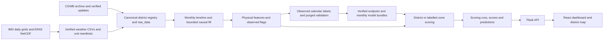

# AquaIQ audit and repair — 17 October 2026

Repository: `C:\Users\Yasharth\Downloads\AquaIQ`, branch `main`, starting commit `c567b36`.
This report describes the local checkout and supplied artifacts. No external datasets were downloaded, no packages were installed, and no changes were committed or pushed.

## 1. Executive assessment

The software pipeline is reproducible on the available environment, but the evidence does **not** establish a reliable operational nationwide groundwater forecast. The strongest remaining problems are sparse recent observed labels, old weather inputs, missing groundwater evidence, uncalibrated project risk scores, and sensitivity that must not be interpreted causally.

The existing repairs to physical units, causal groundwater filling, exact calendar targets, chronological embargoes, model checksums, canonical IDs and unavailable results were verified. Additional defects were repaired in initialization, artifact publication, coverage reports, input validation, alert/map visibility, auxiliary statistics, model evaluation and documentation. Original source datasets and active model bundles were preserved.

An isolated complete replay produced 725 district score records and **721 non-empty forecasts**, with unavailable records retained explicitly. It regenerated the same feature generation and model hashes as the active release. Production database and artifact hashes before/after the replay were equal. See `audit-2026-10-17/pipeline_verification.json` for the final run's evidence.

The saved direct XGBoost test RMSE is **0.619249 m**, versus **0.009301 m** for persistence, on only **10 labels from four districts**, January–March 2023. The validation winner among the measured candidates was Random Forest; its final test RMSE was 0.884433 m. Neither result justifies promoting a replacement or reporting an accuracy percentage. Active checkpoints were retained.

## 2. Audit order and architecture

Work followed repository inspection → source/database inventory → observed-label model evaluation → targeted repairs → backend/frontend checks → full isolated replay. Priorities were correctness and provenance, then coverage and error handling, then reproducibility. Existing datasets and checkpoints were examined before edits.



Entry points and responsibilities:

| Area | Paths and behavior |
|---|---|
| Setup | `setup.ps1`, `setup.sh`, `requirements.txt`, `config.yaml`, private `.env` |
| Ingestion | `data_ingestion/ingest_cgwb.py`, `ingest_imd_era5.py`, `enrich_districts.py`; crosswalk and state-qualified identities |
| Source transformations | `imd_district_climatology.py`, `era5_to_district.py`; daily rainfall totals and explicitly checked evaporation units |
| Incremental inputs | `cgwb_updates.py`, `imd_realtime*.py`, `merge_rainfall_update.py`, `scripts/stage_rainfall_update.py`; candidate staging/provenance |
| Preprocessing | `preprocessing/pipeline.py`; continuous monthly grid, groundwater LOCF ≤3 months, weather LOCF ≤2 months |
| Features | `preprocessing/features.py`; calendar groundwater lags, trailing rainfall, prior-year same-month normals, water balance and crop-season flags |
| ML | `models/xgboost_model.py`, `climate_forecast.py`, `backtest.py`, `monthly_projection.py`, candidate validation/evaluation scripts |
| Serving scores | `models/ensemble.py`, `tiers.py`, `score_all.py`; real district/zone evidence, documented project risk scale, complete batch publication |
| Database | `db/schema.sql`, `db/init_db.py`, provenance migration 003; district/alias registry, raw observations, features, predictions, scores, scoring runs |
| API | `api/app.py`, `api/contracts.py`, `api/district_resolver.py`, `api/routes/` |
| Dashboard | `dashboard/src/api.js`, pages, `MapComponent.jsx`, `districtMap.js`; Vite proxy and React rendering |
| Deployment | `deploy/serve.py`, Dockerfiles, Compose and Nginx; existing restored database and matching artifact release required |
| Verification | `scripts/verify_pipeline.py`, `audit_data_quality.py`, `audit_postgres_export.py`, `models/audit_evaluation.py`, `tests/`, `dashboard/tests/` |

Python 3.13.15 and Node 22.18.0 were available; PostgreSQL reported 18.1. Existing pins passed `pip check`. Dependency versions were not changed. Docker was unavailable, so container builds, restart recovery and public deployment were not verified. This was a replay in the existing dependency environment, not a fresh package installation.

## 3. Issues, evidence, causes and disposition

No current critical defect was confirmed. High/medium findings below include issues reproduced with malformed-input regression fixtures; these are distinguished from defects observed in the supplied records.

| Severity | Evidence / root cause | Repair or remaining limitation |
|---|---|---|
| High | `models/xgboost_model.py`, saved card and measured `model_evaluation.json`: final test has ten labels/four districts and XGBoost loses to persistence. New January 2026 readings do not create usable six-month labels when matching recent origins/weather are absent. | Report measured MAE/RMSE/R², separate validation/final test, include baselines/candidates and district/horizon details. Current-period accuracy remains unestablished; no automatic model promotion. |
| High | `preprocessing/features.py:317`: active feature CSV/manifest were written before database validation/insertion. A failed DB rebuild could invalidate the active artifact release. | Serialize to staging first; reject/fail DB publication before replacing active files. Regression proves both active files remain unchanged on DB rejection. This is not a cross-resource crash-atomic release protocol; matching-generation guards remain necessary. |
| High | Clean `db/schema.sql`/ingestion did not initialize/populate `legacy_district_ids`; resolver aliases depended on historical migration state. `run_pipeline.py` also omitted zone enrichment. | Initialize the alias registry, validate and persist the recorded crosswalk during ingestion, and enrich zones before weather. Isolated transaction regression verifies a new alias resolves while source records remain untouched. |
| High | `api/routes/simulate.py`: JSON numeric/bool dates could become epoch timestamps; bools and numeric strings were accepted as percentage numbers. | One strict calendar-date validator for JSON/query cutoffs; finite JSON numbers only, booleans/strings/overflow rejected before DB access. Invalid requests return 400. |
| High | `models/statistical_tests.py`: forward-filled values could become observed truth, annual row differences bridged missing years, and repeated district-years inflated inference samples. | Use verified observed depths, adjacent-year matching calendar months, and paired district period means. Statistical results remain exploratory because well composition and spatial dependence are unresolved. Old `data/processed/ttest_results.csv` was preserved and must not be represented as a regenerated result. |
| Medium | `dashboard/src/pages/Alerts.jsx:47` requested 100 records; API returned count without total/truncation disclosure. | Request up to 1,000; API returns `total`/`has_more`; UI displays count/category coverage. Live All response includes all 725, including four unavailable districts. |
| Medium | Boundary source contains 34 state polygons among 760 features; missing geometry could hide records. Earlier enrichment matched names globally/fuzzily. | Filter state polygons, test same-state matching, expose unmapped district links, and use only exact/recorded aliases for enrichment. Measured map coverage is 724/725; Mumbai Suburban has no matching supplied geometry. |
| Medium | `dashboard/src/api.js:46` default history end was 2024-12. DistrictDetail already supplied its own current end, so the default bug affected callers relying on defaults. | Let API choose the current end. Live histories contain all 297 timeline months through September 2026, with missing/imputed flags; this does not claim September groundwater was observed. |
| Medium | `models/data_readiness.py` hardcoded 276 monthly records, counted raw rows and swallowed DB failures; active serving already used observed monitoring cadence. | Compatibility helper now delegates serving evidence selection. No change to configured scientific thresholds. See readiness explanation below. |
| Medium | `data_ingestion/data_completeness.py` joined numeric IDs to weather names, omitted states, counted rows/out-of-period years and used fixed 276 months. | Canonical IDs, state-qualified aliases, distinct finite months inside configured dates, explicit zero-coverage districts, diagnostics and separate report outputs. |
| Medium | `models/climate_forecast.py:141` seasonal-naive evaluation depended on input row order; overall reporting hid district/date coverage. | Sort known observations before selecting the most recent same-month value; add dates and district/horizon metrics. Shuffled-input regression matches ordered input. |
| Medium | Direct bundle loader verified checksums/schema but did not enforce its recorded maximum training label/origin dates. | Validate cutoff/calendar-horizon consistency; rehashed invalid-card regressions are rejected. Checksums are integrity checks, not independent scientific certification. |
| Medium | `models/ann_classifier.py` used sklearn random validation early stopping inside an auxiliary time-series experiment. Labels imitate the FIS rather than observed crisis outcomes. | Disable random holdout early stopping; retain chronological final split and training-only scaling. ANN agreement is not forecast accuracy or independent crisis validation. |
| Medium | `preprocessing/correlation_analysis.py` used nonexistent `data/raw/cgwb/cgwb_combined.csv`, name-only aggregation/joins and state-less map merges. | Resolve actual source path from project root, use state-qualified keys, reject duplicates and write separate candidate artifacts. Actual run produced 532 state-qualified correlations. |
| Medium | `models/plot_predictions.py` expected uppercase depth and could treat filled rows as actuals; irregular rows were indexed as equally spaced time. | Load verified observed physical depths, expose compatible column alias, and calculate elapsed calendar months. |
| Medium | `ingest_cgwb.py`: malformed nonfinite readings could poison a district mean; conflicting legacy IDs silently used the last CSV mapping. Current active raw table contains no nonfinite GWL. | Reject ambiguous identities and exclude nonfinite readings before aggregation; tests reproduce both cases. Source files preserved. Negative source levels are not blindly discarded because artesian observations can be negative. |
| Medium | No active `predictions.csv` was present; database contains 4,326 historical predictions, so absence was not evidence of empty model output. | Isolated full replay exports real `predictions.csv` (721 rows) plus complete `crisis_scores.csv` (725 rows). Four unavailable districts remain in the score export rather than receiving fabricated forecasts. |
| Low | `download_era5.py` constructed an optional credentialed CDS client on import, used CWD-relative output and printed an incomplete evaporation conversion hint. | Construct client only when run, use project-root paths, point to optional dependencies and metadata-aware conversion. No download/client authentication was performed. |
| Low | Vite build emits an approximately 809 kB minified JavaScript chunk. | Build succeeds; bundle splitting remains a performance improvement. No unrelated UI redesign was undertaken. |

### Previously reported risks checked explicitly

1. **Scaling/units:** current features and bundles use metres below ground level, mm/month and °C. No inverse target scaling is required. Re-training reproduced both active model hashes. The old dump is a historical artifact and is not a serving input.
2. **725/716:** current master and crosswalk have 725 canonical IDs. Current state-qualified boundary matching finds 724, not 716. No count was blindly changed. Historical 716 is not the measured current serving count.
3. **Coverage:** APIs and latest score run cover all 725; 427 district estimates, 294 labelled zone fallbacks and four unavailable. Raw groundwater covers only 652 districts; weather/boundaries cover 724. Geometry is not invented for Mumbai Suburban.
4. **Risk definitions:** shared `models/tiers.py` implements project scores; integer tiers remain Safe 0–30, Watch 31–60, Warning 61–80, Crisis 81–100. These are not official groundwater classifications. Uncalibrated initial weights are now disclosed on score screens.
5. **Climate extremes:** maximum rainfall reproduces archived daily grids; extreme relative anomalies can arise from tiny positive historical normals. No arbitrary clipping or threshold widening was used. Constructed dry/hot stress produced a slightly shallower direct estimate than baseline (33.119 vs 33.449 m); this unconstrained model must not be treated as a causal drought/policy simulator.
6. **Staleness:** 639 districts' latest raw groundwater month is January 2026; 13 have older observations and 73 have none. IMD ends December 2025, ERA5 December 2024. Jaipur/Pune endpoint forecasts correctly report January 2026 origin → July 2026 target as historical. November 2026–April 2027 graphs are labelled projections using estimated anchors and weather assumptions.
7. **Exports:** non-empty exports were regenerated in isolated scratch outputs, leaving the active database/bundles untouched.
8. **166/24:** 166 was ceil(60% × 276 calendar months), a legacy monthly denominator. Current configuration covers 297 months/99 expected quarterly monitoring rounds; district eligibility requires at least 24 observed months **and** 60% coverage (60 observed months at this cutoff). Monthly curve fitting separately requires 24 actual observations spanning at least 36 months. Feature completeness percentages are not observation coverage.

## 4. Data quality measurements

Detailed, per-column and per-file evidence: `data_quality_audit_2026-10-17.json` and `.md`. Inventory inspected 36 non-scratch CSVs and 41 binary/geospatial/source artifacts. Scratch fixtures and isolated replays were listed separately; test fixtures were not treated as observations. All five active preprocessing/weather/feature CSV manifest hashes matched.

| Dataset/table | Rows | District coverage | Dates / qualification |
|---|---:|---:|---|
| Raw CGWB combined CSV | 1,514,984 | 559 mapped | 1996-05–2023-03; 148,328 rows unmapped/missing codes; district_code missing 9.7907% |
| CGWB changes CSV | 550,850 | 490 mapped | 2013-01–2023-03; 54,019 unmapped rows |
| IMD processed CSV | 295,392 | 724 | 1992-01–2025-12; no missing rainfall or duplicate district-month keys |
| ERA5 processed CSV | 199,824 | 724 | 2002-01–2024-12; no missing temperature/ET or duplicate district-month keys |
| Preprocessed/features | 215,325 each | 725 | Exactly 297 months/district, 2002-01–2026-09; no duplicate monthly keys or invalid dates |
| Live raw_data | 741,628 | 725 across sources | CGWB 46,588 rows/652 districts; weather 724 districts |
| Live predictions | 4,326 | 721 | Multiple historical runs; endpoint dates through 2026-07 |
| Live crisis_scores | 2,175 | 725 | Three retained scoring dates; current matching publication complete |

Features contain 36,890 observed groundwater months, 72,110 carried-forward months and 106,325 unavailable groundwater months. Groundwater missingness is **49.3788%**; rainfall 2.4916%; temperature and ET 6.5264%. No observed/imputed flag conflicts, observed-feature/raw groundwater mismatches, nonfinite stored groundwater values, master-name duplicates or orphan foreign keys were measured. The timeline is monthly; actual quarterly observation gaps are not converted into invented observations.

Raw combined CGWB exact full-row duplicate count is zero. Excluding source record ID and comparing station/date/location/value/source metadata found one candidate repeated measurement; it was preserved because metadata equality alone does not prove an erroneous observation. Raw levels range −2.33 to 534 m; five values exceed the audit's review-only −10..300 m bounds, not automatic rejection limits. Raw ordering is irregular; preprocessing sorts explicit dates.

Recomputed rainfall maximum: South West Khasi Hills, Meghalaya, June 2022, **5,227.885742 mm**, spatial mean of two complete daily grid cells. Stored CSV value: 5,227.8857. Temperature range −24.39..37.88 °C; monthly potential ET 0..373.98 mm. Surat February 2003's 346,482.56% rainfall anomaly comes from 16.596527 mm against an eleven-prior-year same-month mean of 0.00478862 mm. Such relative extremes need interpretation, not silent clipping. See `audit-2026-10-17/extremes_verification.json`.

The 22,464,250-byte pre-migration PostgreSQL dump was parsed using `pg_restore --data-only --file=-`, without a DB connection or restoration. It contains 1,291 district rows, 1,094,793 raw rows, 402,289 feature rows, and zero scores/predictions. This older mixed-identity snapshot must not be substituted for the current canonical release. Its per-table dates, null counts and numeric-ID coverage are in `audit-2026-10-17/database_export.json`.

The 725 IDs are repository administrative identities, not a verified census of every current Indian district. No authoritative current national registry was supplied or downloaded. Boundary/administrative changes, unmapped source codes, comparable-well identities, publication/revision times and source authenticity remain limitations. Weather carry-forward policy is in manifests; field-by-field raw weather lineage is less granular than groundwater flags.

## 5. Model evaluation

Target: **depth in metres below ground level**, not depletion rate. The direct model forecasts exactly origin +6 calendar months. Its targets must be explicitly observed; bounded causal carry-forward can be input evidence but cannot become a label. Lag joins use calendar dates. Rainfall normals use previous years of the same month, excluding future climatology. Preprocessing/scaling for Ridge/RF is fitted on training rows only. No MAPE is reported because groundwater can be zero/near zero. Prediction intervals are not independently calibrated.

Direct comparison: training targets through 2019-12-31, 32,318 labels from 559 districts; six-month embargo before validation origins. Validation: 108 cases/11 districts, origins July 2020–June 2022, targets January 2021–December 2022. Final test: ten cases/four districts, origins July–September 2022, targets January–March 2023. The target windows do not overlap. Previously inspected saved holdouts are not a newly blinded trial.

| Direct model | Validation N | Validation MAE m | Validation RMSE m | Test N | Test MAE m | Test RMSE m | Test R² |
|---|---:|---:|---:|---:|---:|---:|---:|
| Saved XGBoost | 108 | 1.027904 | 1.564375 | 10 | 0.500033 | 0.619249 | 0.985103 |
| Persistence | 108 | 0.733476 | 1.865052 | 10 | 0.002941 | 0.009301 | 0.999997 |
| Seasonal naive | 97 | 0.935621 | 1.920787 | 10 | 0.002941 | 0.009301 | 0.999997 |
| Ridge, alpha 10 | 108 | 1.340175 | 1.968127 | 10 | 0.397987 | 0.424511 | 0.992999 |
| Random Forest, 150 trees | 108 | 0.993217 | **1.471282** | 10 | 0.607851 | 0.884433 | 0.969612 |

Random Forest was selected by validation RMSE among models covering every validation case. Seasonal naive is also compared on its available paired subset; its N differs, so its overall validation row is not a like-for-like full-sample ranking. The detailed JSON includes common-subset comparisons, all district metrics and horizon-six metrics. High aggregate R² is strongly influenced by differences between district depths and is not an accuracy percentage.

Expanding-origin direct backtest replay:

| Development fold | Training labels | Evaluation labels | XGBoost RMSE m | Persistence RMSE m | Seasonal paired XGB / naive RMSE m |
|---|---:|---:|---:|---:|---:|
| expanding-2014 | 17,722 | 6,759 | 2.306654 | 2.962327 | 2.277337 / 2.198738 (N=6,561) |
| drought-2018 | 26,790 | 3,819 | 2.867099 | 3.844334 | 2.684181 / 2.657983 (N=3,248) |
| recent-2020 | 31,205 | 430 | 3.474782 | 3.831719 | 3.429780 / 3.198172 (N=414) |

These are development windows; candidate ensemble weights were reported and not promoted. See `audit-2026-10-17/backtest_results.json` for exact boundaries and metrics.

Monthly conditional model: 60,974 observed training pairs; serving/evaluation uses prior same-month weather averages available at each origin, not realized future weather. Validation contains 1,876 cases/510 districts, target August 2020–December 2022; RMSE 2.488922 m, MAE 1.246590 m, versus persistence RMSE 2.813577 m. On 1,833 common seasonal cases, XGBoost RMSE 2.507777 m versus seasonal naive 2.436527 m.

| Monthly horizon | Validation cases | Validation XGB RMSE m | Final cases | Final XGB RMSE m |
|---|---:|---:|---:|---:|
| 1 | 139 | 1.038147 | 10 | 0.606209 |
| 2 | 628 | 1.596772 | 10 | 0.653360 |
| 3 | 453 | 3.525507 | 10 | 0.773280 |
| 4 | 116 | 1.771375 | 10 | 1.008114 |
| 5 | 438 | 2.816977 | 10 | 1.044154 |
| 6 | 102 | 1.980816 | 10 | 1.300084 |

Monthly final test aggregates 60 forecast cases over the same four districts/January–March 2023 targets: RMSE 0.929973 m, MAE 0.818847 m, R² 0.966402; persistence/seasonal RMSE 0.009301 m. These are multiple horizon/origin cases, not 60 independent new target observations. Observed-origin historical evaluation does not validate today's estimated anchors, zone projections or a multi-year gap.

Full measured report: `audit-2026-10-17/model_evaluation.json`. Row cases are an ignored local CSV. No production weights/checkpoints were replaced and no invented accuracy/interval coverage was reported.

## 6. Verification results

Completed checks (final machine-readable summary: `audit-2026-10-17/verification_summary.json`):

| Command/check | Result |
|---|---|
| `python -m pytest -q -m "not requires_db" --basetemp=scratch/pytest-audit-verified-20261017` | 803 passed, no failures; 11 warnings (NumPy/netCDF deprecations and single-label test fixture) |
| `python -m pytest --integration -q -m requires_db --basetemp=scratch/pytest-audit-last-db-20261017` | 13 passed, no failures; includes clean alias initialization |
| `python -m compileall -q api db data_ingestion models preprocessing scripts tests` | Passed |
| `python -m pip check` | No broken requirements |
| `python tests/smoke_test_data.py` | 28/28 checks passed; these are load/format checks, not scientific validation |
| `npm test` in dashboard | 11/11 passed |
| `npm run lint` in dashboard | Passed |
| `npm run build` in dashboard | Passed; 607 modules, 809.46 kB JS; chunk-size warning remains |
| Read-only live Flask client | 22 GET checks plus zero-change/invalid POST cases passed; all 725 stored scores matched API values exactly |
| `python -m scripts.audit_data_quality --database --as-of 2026-10-17` | Reports written, read-only setting verified, source/manifest/coverage inventory complete |
| `python -m scripts.audit_postgres_export` | Historical dump parsed without restoring/connecting |
| `python -m data_ingestion.data_completeness --output reports/audit-2026-10-17/source_completeness.csv` | 725 canonical rows/297-month denominator; originals preserved |
| `python -m preprocessing.correlation_analysis` | Passed on real sources; candidate CSV/figure written separately |
| `python -m models.audit_evaluation --output-dir reports/audit-2026-10-17 --include-monthly` | Saved bundles + Ridge/RF/baselines evaluated; report only |
| `python -m scripts.verify_pipeline --run --output-dir scratch/audit-pipeline-final-2026-10-17 --as-of 2026-10-17` | Final six-stage replay and production hash evidence in pipeline_verification.json |

Initial sandbox attempts to reach localhost PostgreSQL and the default pytest temporary directory were restricted. DB commands subsequently used permitted local access; tests used writable scratch directories. No failed environment attempt is counted as a passing check. Migration regressions run in unique transaction-scoped schemas and roll back. The full replay uses a separate schema, writes to scratch, and removes its schema afterward.

Live district checks included Jaipur, Pune and insufficient-data Nicobars, invalid IDs, unsupported horizons, bad dates, alert limits, zero-change simulations and strict JSON-null behavior. Jaipur/Pune monthly graphs contain six labelled projections, November 2026–April 2027; Nicobars returns an empty unavailable graph. API `healthy` means DB/model compatibility, not scientific accuracy. Browser pixels and Docker/public-host deployment were not independently exercised.

## 7. Reproduction and remaining limits

From an activated environment in the repository root, restore/configure the supplied real database/source/artifact release first. Git excludes the large data/model assets. `setup.ps1`/`setup.sh` creates the environment and schema; `.env.example` is a template, not credentials. A completely empty database cannot reproduce the incremental 2026 observations unless those verified updates are restored or ingested.

```powershell
python -m pip check
python -m scripts.audit_data_quality --database --as-of 2026-10-17
python -m scripts.audit_postgres_export
python -m models.audit_evaluation --output-dir reports/audit-repeat --include-monthly

# Prints a plan; --run uses a fresh scratch path and temporary DB schema.
python -m scripts.verify_pipeline
python -m scripts.verify_pipeline --run --output-dir scratch/audit-repeat --as-of 2026-10-17

# Actual release rebuild: back up DB/data/checkpoints first. These commands publish derived assets.
python scripts/run_pipeline.py --step all
# Or individual derived stages against existing ingested sources:
python scripts/run_pipeline.py --step preprocess
python scripts/run_pipeline.py --step features
python scripts/run_pipeline.py --step train
python scripts/run_pipeline.py --step backtest
python scripts/run_pipeline.py --step score_all --as-of 2026-10-17

# Saved-bundle evaluation; no fitting/publication:
python -m models.xgboost_model --eval
python -m models.climate_forecast --eval

python -m api.app
# In a separate activated terminal:
cd dashboard
npm ci
npm test
npm run lint
npm run build
npm run dev
```

The replay's `predictions.csv` and `crisis_scores.csv` are the reproducible export command's outputs; ordinary `score_all` publishes to PostgreSQL. The existing environment's dependencies were reused; `npm ci` is the documented clean installation command, not a claimed new installation in this audit.

Unresolved limitations: contemporary official district registry/boundary completeness; missing Mumbai Suburban geometry; unmapped source codes; sparse/old groundwater and ERA5; independent source-publication times and comparable-well panels; groundwater extraction/pumping measurements; current-period/zone/estimated-anchor evaluation; calibrated prediction intervals; independently calibrated crisis weights; noncausal model sensitivities; large frontend bundle; cross-resource crash recovery; remote/container/browser visual verification. None were hidden with fabricated data, tuned thresholds or invented accuracy. This project should remain an exploratory decision-support prototype under these limits.

No obvious live-token/private-key patterns were found in tracked text, `.env`/dump/model outputs are ignored, and `.env` was not found in tracked history. This is a scoped scan, not proof that every historical secret is absent. Private credentials were neither printed nor changed.

## 8. Files and Git state

The following manifest lists every changed/new source and test file and its purpose. Generated compact reports are listed separately in the machine-readable Git status. Full working-tree status is captured after final verification. No commit, push, deployment or external message was performed.

<!-- FILE_MANIFEST -->

| Exact repository-relative path | Modification |
|---|---|
| `.gitignore` | Ignore row-level audit exports and generated correlation artifacts. |
| `README.md` | Describe measured audit limitations and isolated reproduction commands. |
| `api/contracts.py` | Share strict calendar-date validation across JSON and query inputs. |
| `api/routes/alerts.py` | Disclose total and truncated alert results. |
| `api/routes/district.py` | Validate cutoff before resolving/querying district evidence. |
| `api/routes/simulate.py` | Validate finite numeric policy inputs and strict calendar cutoffs. |
| `api_spec.md` | Document new date/input and alert coverage contracts. |
| `dashboard/package.json` | Run every dashboard regression test file. |
| `dashboard/src/api.js` | Remove stale default history end; retain request sharing/retries. |
| `dashboard/src/components/MapComponent.jsx` | Use verified district matching, filter state geometry and expose unmapped records. |
| `dashboard/src/pages/Alerts.jsx` | Request all canonical districts and disclose result coverage. |
| `dashboard/src/pages/DistrictDetail.jsx` | Disclose uncalibrated project ensemble weights. |
| `dashboard/src/pages/Home.jsx` | Disclose project score calibration status. |
| `dashboard/tests/api.test.js` | Regress current-ended history requests. |
| `data_ingestion/data_completeness.py` | Replace incorrect source joins/denominators with finite, distinct canonical month coverage. |
| `data_ingestion/download_era5.py` | Avoid optional credentialed client construction on import and correct unit instructions. |
| `data_ingestion/enrich_districts.py` | Use recorded same-state boundary aliases and exact state zone proxies. |
| `data_ingestion/ingest_cgwb.py` | Bound DB access, reject ambiguous IDs/nonfinite readings, initialize validated identity aliases. |
| `db/schema.sql` | Create identity registry during clean initialization. |
| `docs/AUDIT_REPORT.md` | Mark older audit measurements and proposed work as a historical snapshot. |
| `docs/AquaIQ_Context_Brief.md` | Point historical planning context to current measured forecast semantics and audit. |
| `models/ann_classifier.py` | Disable random validation early stopping in auxiliary FIS imitation. |
| `models/climate_forecast.py` | Make seasonal baseline order-independent and expose district/horizon/date coverage. |
| `models/data_readiness.py` | Reuse serving observed monitoring-round eligibility instead of legacy monthly counting. |
| `models/plot_predictions.py` | Plot verified observed physical depths against calendar time. |
| `models/statistical_tests.py` | Use observed adjacent-year matched months and paired district period means. |
| `models/xgboost_model.py` | Reject inconsistent recorded training cutoffs/origins in bundles. |
| `preprocessing/correlation_analysis.py` | Repair source path, state-qualified joins and separate report outputs. |
| `preprocessing/features.py` | Stage artifacts so DB failure preserves active CSV/manifest. |
| `preprocessing/pipeline.py` | Reuse bounded shared DB connection and preserve script imports. |
| `scripts/run_pipeline.py` | Include zone and map-name enrichment in complete ingestion. |
| `tests/test_migration_safety.py` | Regress clean alias initialization while preserving source rows. |
| `tests/test_sample_isolation.py` | Regress active-file preservation on DB publish failure. |
| `dashboard/src/districtMap.js` | Extract and test state-qualified map matching/coverage. |
| `dashboard/tests/districtMap.test.js` | Regress actual boundary filtering, same-state identities and missing Mumbai Suburban. |
| `models/audit_evaluation.py` | Measure saved XGBoost, naive, Ridge and RF candidates on independent temporal windows. |
| `scripts/audit_data_quality.py` | Inventory all source CSVs, provenance, geography, manifests and read-only database quality. |
| `scripts/audit_postgres_export.py` | Inspect historical PostgreSQL COPY rows without connecting/restoring. |
| `scripts/verify_pipeline.py` | Replay all stages in a temporary schema/scratch release and verify production hashes. |
| `tests/test_api_audit_regressions.py` | Regress strict inputs, request validation and full alert coverage. |
| `tests/test_audit_data_quality.py` | Regress coverage windows, canonical/state identity, finite months and cross-chunk duplicates. |
| `tests/test_audit_ingestion.py` | Regress enrichment order, state-safe matches, ambiguous IDs and nonfinite groundwater. |
| `tests/test_correlation_identity.py` | Regress state-qualified EDA and actual source layout. |
| `tests/test_model_audit_repairs.py` | Regress bundle dates, baseline order, training-only selection, observed stats and ANN split. |
| `tests/test_pipeline_verification.py` | Regress isolated replay output protection and offline plan. |
| `tests/test_postgres_export_audit.py` | Regress dump parsing and truncated-export rejection. |
