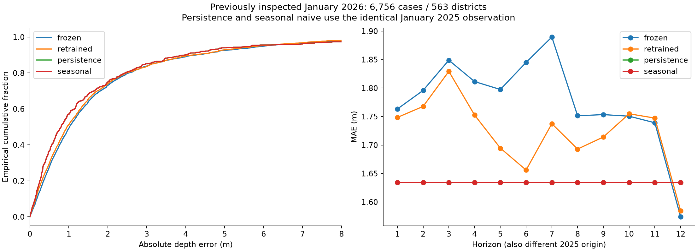
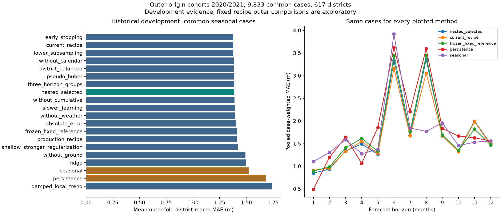

# AquaIQ accuracy experiments — 27 October 2026

## Executive finding

This completed historical development experiment compares sixteen supported recipes and two baselines. The nested selection procedure obtains **1.464994 m case-weighted MAE**, **1.388311 m mean outer-fold district-macro MAE**, and **3.262515 m RMSE** on 9,833 common cases across 617 districts. The comparison below gives exact differences, including regressions. These are retrospective development results, not an untouched final test.

The final inner-only selection is **`three_horizon_groups`**. An isolated final candidate was fitted twice on 145,494 genuine pairs across 641 districts, with labels through 31 January 2025. Its checkpoint is `models/artifacts/accuracy_experiments_20261027_run_v2_three_horizon_groups/checkpoint.json`. Repeated rounded depth predictions match exactly; reload maximum depth difference is 0.00000000 m. The current experimental candidate remains retained as a reference.

The new selection procedure does **not** demonstrate an improvement over the current recipe on outer district-macro MAE: grouped horizons change it from 1.377637 to 1.388311 m (+0.77%), with worse RMSE. Retain the existing candidate for further prospective testing; the new grouped artifact is a rejected replacement and a reproducible research reference. Early stopping alone changes outer macro MAE by only -0.000551 m (-0.04%), which is practically negligible and was not selected by the locked inner ranking. No alternative was chosen after seeing outer results.

**Production promotion is prohibited.** The production pointer, frozen weights, current experimental candidate and prior reports are unchanged. The public-table before/after fingerprints match. No new forecast generation or production API data was published. The original untouched-test requirement and all original numerical safeguards remain in force.

## Original results reproduced independently

The audit reproduces every original panel MAE/RMSE from the actual saved case records within 1e-12 m, including all six historical validation exports. All measured target keys/values match accepted observed source rows. The complete historical serving panel has 7,668 cases / 639 districts; persistence covers 7,560 / 630 and the four-way panel covers 6,756 / 563. Persistence is missing on 108 cases; seasonal naive is missing on 912. There are 96,732 unlabelled slots among 104,400 potential district/origin/horizon slots. Missing labels remain missing.

The following four-way values use exactly the same 6,756 cases; units are metres below ground level. Positive signed errors mean predicted depth is too large.

| Method | MAE | RMSE | Median absolute error | Signed error | Overestimate fraction |
| --- | ---: | ---: | ---: | ---: | ---: |
| frozen | 1.776656 | 2.938660 | 1.020500 | -0.118839 | 50.755% |
| retrained | 1.723345 | 2.884739 | 0.954013 | -0.138535 | 49.378% |
| persistence | 1.634254 | 2.885459 | 0.800417 | -0.233813 | 47.780% |
| seasonal | 1.634254 | 2.885459 | 0.800417 | -0.233813 | 47.780% |

The audit independently resolves each baseline's source timestamp and value. Both definitions correctly use **January 2025** on every seasonal-supported district at all twelve 2025 origins: it is the exact prior-year January observation and also the latest eligible measurement. There are no later measured months in 2025. Their equality is expected, not an implementation conflation. Seasonal values never fall back to persistence; missing seasonal cases remain excluded from every method in the paired panel.

Eight representative A/B/C serving paths, including January/December origins and Gandhinagar, exactly reproduce the actual saved `forecast[h-1].predicted_gwl` field through the original tiered dispatcher. Model predictions are changes; serving reconstructs the origin anchor plus change, applies the zero floor and rounds public depth to four decimals. The external comparison correctly uses **latest measured persistence**. The embedded Tier A API baseline can instead hold an estimated current anchor; these are different documented quantities and were not substituted.

Evidence: [baseline audit](audit_v2/baseline_audit.json), [serving replay](audit_v2/serving_replay.json), [historical validation reproduction](audit_v2/historical_validation_reproduction.json). Row traces and the rebuilt pair CSV remain local and ignored by Git. The requested `training/acceptance.json` does not exist; the actual acceptance receipt is at the previous report root.

## Error diagnostics and root-cause limits

On all 7,668 historical cases, frozen/retrained MAE is 1.777519/1.728657 m, RMSE 3.055598/3.008508 m, and signed error -0.040926/-0.056567 m. The retrained model overestimates depth in 52.713% of cases. Small aggregate bias coexists with substantial individual errors.

The evidence does **not** show aggregate systematic overreaction. Relative to the latest measurement, retrained predicted-change standard deviation is 1.695474 m versus actual-change standard deviation 2.793654 m; mean absolute predicted/actual changes are 0.874649/1.618984 m. It predicts a larger absolute change in 35.040% of cases and a different direction, including zero, in 42.169% of nonzero-change cases. These descriptive statistics include estimated-anchor effects and cannot isolate the learned delta from anchor error.

Persistence remains better on the historical four-way panel despite the refit's improvement over frozen weights. Tier B local-persistence and Tier C regional-reference paths do not change with model weights. Tier C has 108 cases in only nine districts, MAE 6.100983 m for both models, and is exploratory. Its lack of local labels prevents either baseline; four-way matching must not hide it. All tier/district/state, horizon, recency, history-count, exact observed/finite lag, projection-lag-fallback, raw origin-weather and enrichment cohorts are exported with support counts. Error quantiles, signed histograms, medians, over/underestimate proportions and change diagnostics are included in `analysis_v2/historical_diagnostics_v2.json` and `run_v2/outer_diagnostics.json`.

The 2025 diagnostic has no finite raw weather at the origin month; the serving climatology/fallback still supplies eligible weather features. All A-tier seasonal-supported cases require a groundwater lag fallback. Consequently these variables are confounded with serving tier/recency and cannot identify a causal source of error. Stale-anchor accuracy remains distinct from observed-origin model accuracy. The sixteen newly local districts have no January 2026 targets. District-level rows are descriptive: a single district cannot satisfy the ten-district support rule.



## Chronology, availability and nested selection

The active, source-sealed protocol is [protocol_v2.json](protocol_v2.json), SHA-256 `a526b1e89964415fe54ee0f0d1b22d9172647972bcdd7ef5a93bb3b128f3e185`. Availability rules choose the last two eligible origin-year cohorts with their **entire twelve-horizon target window ending before 2023**. Training target cutoffs preserve the existing twelve-month origin embargo. Each outer fold uses the last two supported inner windows ending no later than its training-label cutoff: 2020 uses 2016/2017, and 2021 uses 2017/2018. The union 2016–2018 selects the final development recipe independently of outer outcomes.

| Phase / origin year | Training labels through | Train cases / districts | Validation origins | Validation targets | Cases / districts |
| --- | --- | ---: | --- | --- | ---: |
| inner 2016 | 2014-12-31 | 65,300 / 558 | 2016-01-01 to 2016-12-01 | 2016-02-01 to 2017-12-01 | 10,017 / 554 |
| inner 2017 | 2015-12-31 | 76,439 / 558 | 2017-01-01 to 2017-12-01 | 2017-02-01 to 2018-12-01 | 10,209 / 551 |
| inner 2018 | 2016-12-31 | 86,790 / 558 | 2018-01-01 to 2018-12-01 | 2018-02-01 to 2019-12-01 | 9,681 / 549 |
| outer 2020 | 2018-12-31 | 107,034 / 558 | 2020-01-01 to 2020-12-01 | 2020-02-01 to 2021-12-01 | 4,731 / 543 |
| outer 2021 | 2019-12-31 | 116,601 / 558 | 2021-01-01 to 2021-12-01 | 2021-02-01 to 2022-12-01 | 7,412 / 618 |

All horizons have actual training and evaluation cases. M+1 in outer 2020 has only nine districts and is unsupported for subgroup interpretation; all missing and small panels remain reported. Target windows overlap across cohorts, so repeated origins, horizons and target months are dependent. The early audit's same-year target availability file is superseded by the active full-horizon protocol; ending targets in the origin year would have removed M+12.

The fixed frozen model was trained through 2019; its predictions contain no post-origin labels on outer origins from 2020 onward, but on the 2020 fold it does not respect the stricter training recipe's 2018 cutoff and twelve-month embargo. It is a historical artifact reference, not a same-cutoff learned control. The current fixed artifact was trained through January 2025 and is contaminated on all these folds. Its separately labelled raw reconstructed-depth diagnostic is **never** ranking or promotion evidence. Refitted production/current recipes provide controlled chronological comparisons on identical training data. No old 2023/2024 validation score or inspected January 2026 value enters tuning, early stopping, feature selection, calibration, architecture choice or the final ranking.

All learned preprocessing is fitted on the training partition only. The pure causal pair builder was rerun without January 2026 labels and matches all 145,494 existing eligible pairs within 1e-12. Future perturbation tests cover groundwater, weather and output fields. The previous retraining also corrected a feature-construction alignment issue while adding observations; its gains cannot be attributed solely to extra data. Historical observation dates do not establish historical publication/receipt availability: this remains a point-in-time limitation, so neither nested evaluation nor this report is called prospective or untouched.

## Locked experiment ledger and actual coverage

The protocol records each recipe's hypothesis, changes, expected benefit, failure mode, folds, support thresholds and metrics. No broad or adaptive search was run. The base is the current 461-tree, depth-four squared-error recipe. All XGBoost fits use seed 42, histogram trees and four workers.

- A: unweighted references versus train-only district-balanced weights, normalized to mean one and equal total mass per training district. Pair-count quantiles and top-ten district training share are in `run_v2/fold_inputs.json`; sample weights do not use labels or validation data.
- B: shared regressor versus three contiguous groups (M+1–4, M+5–8, M+9–12). Individual-horizon models were attempted but fail the declared support rule: earliest-inner M+1 has 430 cases across 66 districts and two target years; M+11 has 293 across 65 districts and two years. The minimum remains 500 cases, 50 districts and five years. Preflight excludes this recipe from all folds without removing validation cases.
- C: up to 480 trees with forty-round inner early stopping; depth two/minimum child weight 120/L2 80/L1 .4; learning rate .02 with inner stopping; or row/column sampling .7/.7. Other base values remain fixed. Outer/final tree counts use inner median best counts, never outer early stopping.
- D: `reg:absoluteerror` and `reg:pseudohubererror` with slope one versus squared error, supported by installed XGBoost 3.4.1. No valid observed target was clipped. Early stopping, where used, monitors delta MAE; recipe selection scores the reconstructed, floored and rounded depth.
- E: remove exactly one declared feature group: groundwater anchor/lag inputs; horizon/calendar encodings; origin/target climatology weather; cumulative weather. The origin anchor is always retained for reconstruction even when removed as a learned covariate. Weather ablation still leaves cumulative weather proxies, and calendar ablation leaves correlated horizon information, so these are conditional information tests rather than causal feature attribution.
- F: median imputation plus missing indicators, scaling and ridge alpha 100, all fitted on training only; and a per-district past-36-month linear trend with a six-month damped trajectory, requiring three observations or explicitly falling back to measured persistence. No new dependency was installed.

Sixteen supported recipes were evaluated on three inner and two outer folds: **80 recipe/fold evaluations**, including five deterministic local-trend evaluations. The grouped-horizon recipe has three learned members, giving 85 learned member fits across the folds. The first partial run stopped on the individual-horizon support failure before any completed fold; its artifacts are retained under `run_v1` and are not scored or selected. `protocol_v2` preflights those same support rules; supported recipes and hyperparameters were unchanged.

The primary metric is equal mean fold district-macro MAE on identical seasonal-supported cases. Each eligible district with at least one case has equal weight within a fold, matching the prior macro convention; this does not turn a small district sample into a supported finding. Case-weighted MAE answers a different question and is separately reported. Full outer coverage is 12,143 cases / 622 districts; seasonal matching excludes 2,310 cases, leaving **9,833 / 617** for every method below. There are no candidate-specific population changes.

## Results and model selection

| Method | Inner mean macro MAE | Outer mean macro MAE | Pooled MAE | RMSE | Signed error |
| --- | ---: | ---: | ---: | ---: | ---: |
| `early_stopping` | 1.330843 | 1.377086 | 1.450701 | 3.132476 | 0.256730 |
| `current_recipe` | 1.331744 | 1.377637 | 1.451129 | 3.135330 | 0.256427 |
| `lower_subsampling` | 1.334492 | 1.378285 | 1.457544 | 3.180880 | 0.266186 |
| `without_calendar` | 1.342895 | 1.385755 | 1.465857 | 3.141423 | 0.281205 |
| `district_balanced` | 1.335001 | 1.385879 | 1.461398 | 3.252521 | 0.220837 |
| `pseudo_huber` | 1.325988 | 1.388227 | 1.454850 | 3.423346 | 0.268281 |
| `three_horizon_groups` | 1.323125 | 1.388311 | 1.464994 | 3.262515 | 0.287157 |
| `nested_selected` | — | 1.388311 | 1.464994 | 3.262515 | 0.287157 |
| `without_cumulative` | 1.333233 | 1.389625 | 1.459695 | 3.138538 | 0.247650 |
| `slower_learning` | 1.356894 | 1.394162 | 1.469080 | 3.215831 | 0.268542 |
| `without_weather` | 1.355706 | 1.395348 | 1.477398 | 3.143983 | 0.242666 |
| `absolute_error` | 1.344440 | 1.402213 | 1.464081 | 3.474629 | 0.268046 |
| `frozen_fixed_reference` | — | 1.410053 | 1.484441 | 3.248228 | 0.255981 |
| `production_recipe` | 1.388761 | 1.413775 | 1.487127 | 3.267229 | 0.277420 |
| `shallow_stronger_regularization` | 1.400482 | 1.420041 | 1.496629 | 3.316830 | 0.291747 |
| `without_ground` | 1.518294 | 1.491670 | 1.559945 | 3.610703 | 0.260678 |
| `ridge` | 1.416438 | 1.496476 | 1.564957 | 2.994124 | 0.218411 |
| `seasonal` | 1.410283 | 1.523177 | 1.597268 | 3.672288 | 0.301549 |
| `persistence` | 2.078394 | 1.682031 | 1.688757 | 3.698013 | 0.157031 |
| `damped_local_trend` | 2.114758 | 1.737870 | 1.750779 | 3.831738 | -0.000769 |

Inner-primary improvements over the current recipe: `three_horizon_groups`, `early_stopping`, `pseudo_huber`. Inner-primary regressions or ties: `district_balanced`, `shallow_stronger_regularization`, `slower_learning`, `lower_subsampling`, `absolute_error`, `without_ground`, `without_calendar`, `without_weather`, `without_cumulative`, `ridge`, `damped_local_trend`. The full outer table shows which improvements transfer. Fixed-recipe outer rankings are secondary exploratory evidence; they were not used to pick another winner.

District balancing worsens outer macro MAE and RMSE, so equalizing training mass does not improve this sample. Robust losses do not improve outer macro MAE and increase RMSE. Removing groundwater inputs produces the largest ablation regression; removing calendar, weather or cumulative groups also worsens outer macro MAE. These are conditional predictive-information findings, not proof of physical causality. Ridge reduces mean fold RMSE but worsens MAE and macro MAE; the damped local trend loses to persistence. There is no reliable new improvement from the tested sophistication.

The current XGBoost recipe nevertheless beats persistence and seasonal naive on these historical observed-origin outer cases. Its loss to baselines in the January 2026 serving diagnostic concerns a different population and estimated-anchor setting. Together the results support conditional historical ML value, not nationwide current-period superiority or a claim that either approach always wins.

| Outer origin cohort | Inner-selected method | Common cases / districts | Selected MAE / RMSE | Selected macro MAE |
| --- | --- | ---: | ---: | ---: |
| 2020 | `three_horizon_groups` | 4,304 / 542 | 1.407937 / 2.764058 | 1.365178 |
| 2021 | `three_horizon_groups` | 5,529 / 612 | 1.509408 / 3.603113 | 1.411443 |

Negative differences favor the nested policy. The following pooled case and district metrics share identical keys; pooled district macro differs from the primary equal mean of fold macro values.

| Reference on identical common cases | Nested policy MAE difference (m) | Relative MAE difference | Macro MAE difference (m, pooled districts) | RMSE difference (m) |
| --- | ---: | ---: | ---: | ---: |
| Frozen artifact | -0.019447 | -1.31% | -0.018974 | 0.014286 |
| Refitted current recipe | 0.013864 | +0.96% | 0.013521 | 0.127185 |
| Persistence | -0.223764 | -13.25% | -0.284916 | -0.435498 |
| Seasonal naive | -0.132275 | -8.28% | -0.145995 | -0.409773 |



## Subgroups, uncertainty and acceptance

The minimum supported panel is thirty cases across ten districts, and the maximum permitted supported horizon/history regression is ten percent relative MAE. There are 2 failed checks and 8 unsupported checks across the two references; checks overlap and must not be added as independent populations. Complete per-horizon/history, state, lag, weather and recency metrics remain in the case-derived diagnostic exports. Different horizon panels contain different districts and target months, so curve differences do not isolate an effect of horizon length.

| Year | Reference | Subgroup | Cases / districts | Selected / reference MAE | Relative regression |
| --- | --- | --- | ---: | ---: | ---: |
| 2020 | current_recipe | horizon=8.0 | 70 / 14 | 2.183472 / 1.977740 | +10.40% |
| 2021 | frozen_fixed_reference | horizon=11.0 | 70 / 20 | 1.365108 / 1.157175 | +17.97% |

Original numerical safeguards applied to the nested selection procedure: mean full-fold macro gain versus frozen +1.93% (two-percent gate: False), versus persistence +21.17% (gate: True); paired seasonal macro no worse: True; supported subgroup gate versus frozen: False. This is a development assessment of fold-selected models, not formal acceptance of final refit weights.

Paired district-cluster resampling uses 2,000 deterministic draws, retaining each district's repeated cases together. Per-fold and pooled descriptive intervals and district win fractions are in [comparison.json](analysis_v2/comparison.json). They do not eliminate shared state/weather/target-month dependence across districts. Two outer origin cohorts, overlapping target windows and changing measurement panels limit practical and statistical confidence; a numerical ranking is not a universal district or horizon improvement.

Untouched post-refit test: **absent**. New final-candidate nationwide serving/API/calibration gates: **not assessed and not claimed to pass**. Existing production/API/legacy-six-month contracts are covered by the full test suite. Promotion remains prohibited regardless of development scores. Old-model calibration is never rebound to new weights; candidate intervals remain unavailable.

## Artifacts, identities and reproducibility

Starting branch/commit: `feature/enriched-xgboost-retraining-20261027` / `d992d396b103a57f04e1ebf433e3591aa626550d`. Work branch: `feature/aquaiq-accuracy-experiments-20261027`.

- Frozen model SHA-256: `4b22e2165664e1c1dd21c81ccf95d894655f0a0d589017a9ab87df0588a73a03`.
- Preserved current candidate SHA-256: `e4e57de9f681b2f2702c9b86a00be06b04147123ecea0579f6abcf3cdc586192`.
- Rebuilt eligible pair CSV SHA-256: `c2bf37a491f93de4859c09119336ec2a74657c203540ba966d578e0ee9869ef9`. Each fold also records its ordered-data fingerprint, exact origin/target ranges, per-horizon support and case export hash.
- Final development choice: `three_horizon_groups`; checkpoint: `models/artifacts/accuracy_experiments_20261027_run_v2_three_horizon_groups/checkpoint.json`; member model hashes: `['2baaffc3eaacd5dca3c473dd0d0a6977ff85ef941ab7658c4411384368430738', '257ae0fdbefd3cf22d5e99349211a15d95f139b1a3305375e6d640b296c29db0', 'd4f09a52f40991ede6f8189637c739d54e4627185ff92960b913c9ccd8112d1f']`; model-card SHA-256: `1fcc69cdebefd38a283b21760307207c89d4cd555fefbab2d9f67e1c787f8d95`.
- Every fold has a new checkpoint/card/member directory under `run_v2/fold_artifacts/`. Cards bind the exact seventeen ordered inference features, fitted subset, target semantics, code hashes, source generation, dataset fingerprint, cutoff, parameters, dependency versions and validation counts. A strict isolated loader checks hashes, order and exact horizon coverage. Full pair/case exports, detailed diagnostics and per-fold learners remain local and Git-ignored; compact reports, protocol and final artifacts are retained.
- Dependencies: `{"numpy": "2.5.4", "pandas": "3.0.6", "python": "3.13.15", "scikit-learn": "1.9.1", "scipy": "1.18.1", "xgboost": "3.4.1"}`. No dependencies, API schemas, canonical IDs, source flags, public data, legacy models, production fallbacks or telemetry quarantine rules changed.

```powershell
.\venv\Scripts\python.exe -u -B -m scripts.audit_accuracy_baselines --output reports/accuracy_experiments_replay/audit
.\venv\Scripts\python.exe -u -B -m scripts.run_accuracy_experiments prepare --audit reports/accuracy_experiments_replay/audit --protocol reports/accuracy_experiments_replay/protocol.json
.\venv\Scripts\python.exe -u -B -m scripts.run_accuracy_experiments run --protocol reports/accuracy_experiments_replay/protocol.json --output reports/accuracy_experiments_replay/run_replay
.\venv\Scripts\python.exe -B -m pytest --integration -o tmp_path_retention_policy=failed --basetemp scratch/pytest-accuracy-replay -q
npm.cmd --prefix dashboard test
npm.cmd --prefix dashboard run lint
npm.cmd --prefix dashboard run build
```

The executed result uses `protocol_v2.json` and `run_v2`. To rebuild figures/tables, run `python -B -m scripts.summarize_accuracy_experiments --root reports/accuracy_experiments_20261027 --run reports/accuracy_experiments_20261027/run_v2 --protocol reports/accuracy_experiments_20261027/protocol_v2.json --analysis-version analysis_replay`. The tool refuses existing analysis/report paths. See [the workflow guide](../../docs/ACCURACY_EXPERIMENTS.md) for required ignored data and isolated inference.

## Executed verification and modified files

Full Python integration suite: **1,772 passed, one skipped, zero failures/errors, seventy warnings**, 413.45 seconds. Focused scientific/contract suite: **136 passed** in 28.86 seconds; it overlaps the full suite. Three additional reporting regression tests passed after the final reporting correction. Frontend: **160 passed**, lint exit zero, build exit zero; largest JS chunk 365,385 bytes. [Verification receipt](verification_v2.json) records actual commands, [pytest.xml](pytest.xml) the full run.

The skip requires Windows directory-symlink privileges. Warnings comprise one sklearn single-label diagnostic, one netCDF4/NumPy binary-size import warning and sixty-eight xarray NumPy-shape deprecations. The first full attempt exhausted disk while retaining raster fixtures and has no valid final summary; only this task's resolved temporary directory was removed, and pytest's passing-fixture cleanup setting fixed the rerun. An initial focused run had one sandbox atomic-replace failure (135 passed); the identical elevated rerun passed all 136. These unsuccessful attempts are recorded, not counted as passes. The initial audit harness reference-helper issue and support-limited partial modeling attempt are also recorded.

Modified files: `.gitignore`, `.gitattributes`; `models/accuracy_experiments.py`, `models/accuracy_challengers.py`; `scripts/audit_accuracy_baselines.py`, `scripts/run_accuracy_experiments.py`, `scripts/summarize_accuracy_experiments.py`; `tests/test_accuracy_experiments.py`, `tests/test_accuracy_challengers.py`, `tests/test_accuracy_reporting.py`; `docs/ACCURACY_EXPERIMENTS.md`; versioned report evidence and any separately named final experimental artifact. Existing candidate, production, training and serving source files are unchanged.

## Evidence still needed

Freeze the selected procedure before collecting genuinely new future measurements, document forecast issuance and source receipt dates, check stable wells/datum/aggregation, and evaluate matching observed targets across all twelve horizons and supported district-history groups. Reassess nationwide serving, stale-anchor behavior, API/rollback contracts and independent interval calibration for the exact candidate weights. Pumping/extraction and observation-panel changes remain unverified explanations, not established causes. This development study cannot establish skill for unlabelled districts or replace the required future test.

Final checks: the 23 scientific/model/reporting tests passed together in 10.95 seconds; this overlaps earlier runs. See [verification_v3.json](verification_v3.json), [artifact verification](artifact_verification.json) and the final [acceptance assessment](acceptance_assessment.json). The superseded analysis_v1 report hid a failed subgroup gate due to a reference-name collision; analysis_v2 corrects that display, without changing any fit, prediction or raw fold gate.
